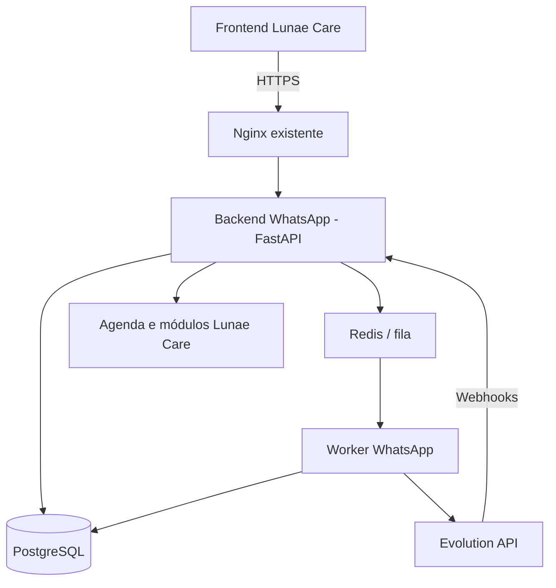
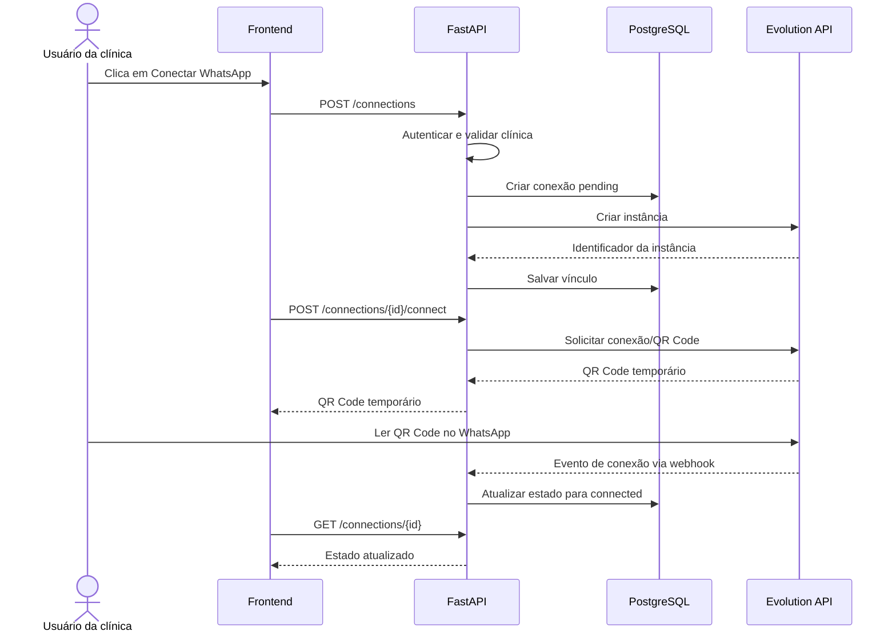

# Lunae Care — Arquitetura do Backend WhatsApp

**Status:** Proposta técnica inicial  
**Stack principal:** Python, FastAPI, PostgreSQL, Redis, worker e Docker  
**Provedor inicial:** Evolution API com conexão por QR Code  
**Objetivo:** oferecer integração WhatsApp multiempresa para clínicas independentes no Lunae Care.

---

## 1. Objetivos e princípios

O backend WhatsApp será um módulo independente do Lunae Care, responsável por gerenciar conexões, mensagens, webhooks e automações de comunicação.

Princípios de arquitetura:

- **Multi-tenant:** cada clínica acessa somente seus próprios dados e conexões.
- **Backend como fronteira de segurança:** o frontend nunca recebe a chave administrativa global da Evolution API.
- **Provedor desacoplado:** regras de negócio independentes da implementação do provedor WhatsApp.
- **Processamento assíncrono:** filas para envios, eventos e tarefas que precisam sobreviver a reinícios.
- **Docker:** serviços isolados, redes privadas e volumes persistentes.
- **Privacidade:** minimizar dados de saúde nas mensagens e nos logs.
- **Evolução futura:** manter a possibilidade de adicionar a API oficial da Meta como outro provedor.

> **Atenção:** a conexão por QR Code normalmente depende de mecanismos não oficiais baseados no WhatsApp Web. Pode haver desconexões, mudanças de compatibilidade ou restrições de conta. Antes de comercializar, valide os termos do WhatsApp e a licença/condições da versão escolhida da Evolution API. A integração deve poder migrar para a API oficial da Meta.

## 2. Arquitetura geral



### Componentes

| Componente | Responsabilidade |
|---|---|
| Frontend Lunae Care | Exibir QR Code, estado da conexão, conversas e automações. |
| Nginx existente | Terminação TLS e proxy reverso, sem expor portas internas desnecessariamente. |
| FastAPI | Autenticação/autorização, regras de negócio, API interna e recebimento de webhooks. |
| PostgreSQL | Persistência de conexões, contatos, conversas, mensagens, jobs e eventos. |
| Redis | Fila e coordenação de tarefas; configurar persistência quando aplicável. |
| Worker | Enviar mensagens, processar filas, realizar retentativas e executar automações. |
| Evolution API | Criar e gerenciar instâncias, gerar QR Code, enviar/receber mensagens e emitir eventos. |

A API e os serviços de dados devem permanecer em redes privadas. Não publique diretamente na Internet as portas do PostgreSQL, Redis ou Evolution API.

## 3. Estrutura sugerida do projeto

```text
lunaecare-whatsapp/
├── app/
│   ├── main.py
│   ├── core/
│   │   ├── config.py
│   │   ├── security.py
│   │   └── tenancy.py
│   ├── api/
│   │   └── v1/
│   │       ├── connections.py
│   │       ├── messages.py
│   │       ├── conversations.py
│   │       ├── webhooks.py
│   │       └── automations.py
│   ├── services/
│   │   ├── connection_service.py
│   │   ├── messaging_service.py
│   │   ├── webhook_service.py
│   │   ├── scheduling_service.py
│   │   └── consent_service.py
│   ├── providers/
│   │   ├── base.py
│   │   └── evolution.py
│   ├── repositories/
│   ├── workers/
│   ├── models/
│   └── schemas/
├── migrations/
├── tests/
├── Dockerfile
├── compose.yaml
├── .env.example
└── pyproject.toml
```

### Responsabilidades importantes

- `core/tenancy.py`: resolve e valida o contexto da clínica a partir da identidade autenticada.
- `providers/base.py`: define um contrato independente do provedor.
- `providers/evolution.py`: encapsula chamadas HTTP à Evolution API.
- `services/`: concentra as regras de negócio; não deve depender diretamente de detalhes HTTP do provedor.
- `repositories/`: consultas e persistência no banco.
- `workers/`: processamento assíncrono de mensagens, eventos e automações.
- `migrations/`: migrações do banco via Alembic.
- `tests/`: testes unitários, integração e isolamento multi-tenant.

## 4. Contrato da API interna

Prefixo sugerido: `/api/v1/whatsapp`

| Método | Endpoint | Objetivo |
|---|---|---|
| `POST` | `/connections` | Criar uma conexão para a clínica autenticada. |
| `POST` | `/connections/{id}/connect` | Iniciar a conexão e solicitar QR Code. |
| `GET` | `/connections/{id}` | Consultar estado da conexão. |
| `POST` | `/connections/{id}/disconnect` | Desconectar o número. |
| `DELETE` | `/connections/{id}` | Remover a conexão e iniciar a limpeza do provedor. |
| `POST` | `/messages` | Enfileirar o envio de mensagem. |
| `GET` | `/conversations` | Listar conversas autorizadas da clínica. |
| `GET` | `/conversations/{id}/messages` | Consultar mensagens de uma conversa autorizada. |
| `POST` | `/webhooks/evolution/{provider_key}` | Receber eventos do provedor. |
| `GET` | `/automations` | Listar regras de automação. |
| `POST` | `/automations` | Criar uma regra de automação. |

### Regras da API

1. Derivar a clínica do usuário autenticado; não confiar em `clinic_id` arbitrário enviado pelo frontend.
2. Validar a propriedade da conexão e da conversa em todas as operações.
3. Aplicar limites de taxa e limites de envio por clínica.
4. Usar paginação em listas e históricos.
5. Proteger endpoints administrativos e de webhook.
6. Retornar erros sem revelar tokens, chaves ou dados de outras clínicas.
7. Gerar QR Code temporário e não registrar seu conteúdo em logs.
8. Implementar idempotência para solicitações de envio e operações que possam ser repetidas.

## 5. Fluxo de conexão por QR Code



Os nomes exatos dos endpoints e os formatos de resposta do provedor devem ser verificados na documentação da versão fixada antes da implementação.

### Estados da conexão

- `pending`
- `connecting`
- `connected`
- `disconnected`
- `error`
- `deleting`

A aplicação deve permitir reconexão, informar desconexões e não exibir QR Code expirado. A exclusão deve ser idempotente e tratar falhas parciais de limpeza.

## 6. Fluxos de mensagens

### Mensagens recebidas

1. O WhatsApp envia o evento ao provedor.
2. A Evolution API encaminha o webhook ao FastAPI.
3. O backend valida a rota/credencial, identifica a instância e confere o vínculo com a clínica.
4. O evento é persistido ou colocado em uma fila durável.
5. Um worker valida e deduplica o evento.
6. O backend atualiza contato, conversa e mensagem.
7. O frontend consulta ou recebe atualização pelo mecanismo de atualização escolhido.

### Mensagens enviadas

1. O frontend envia a solicitação ao FastAPI.
2. O backend valida usuário, clínica, conexão, destinatário e permissões.
3. A mensagem é registrada com estado `queued`.
4. Um job é criado com chave de idempotência.
5. O worker envia a mensagem pelo adaptador do provedor.
6. O backend registra o resultado inicial.
7. Webhooks posteriores atualizam os estados de entrega, quando disponíveis.

### Idempotência e retentativas

- Deduplicar eventos com um identificador estável do provedor; quando indisponível, construir uma chave determinística adequada ao evento.
- Não assumir que todo webhook será entregue uma única vez ou na ordem esperada.
- Usar retentativas com backoff exponencial e jitter.
- Encaminhar falhas permanentes para uma fila de falhas (dead-letter) ou estado de erro revisável.
- Evitar reenvio automático de mensagens quando não for possível saber se o provedor já aceitou o envio.
- Não bloquear a resposta do webhook aguardando processamento demorado; persistir/enfileirar e responder rapidamente.

## 7. Modelo de dados

Usar PostgreSQL, SQLAlchemy e Alembic. Os campos abaixo são uma proposta inicial, não um esquema final.

### `whatsapp_connections`

- `id`
- `clinic_id`
- `provider`
- `provider_instance_id`
- `phone_number` (opcional até a conexão)
- `status`
- `connected_at`
- `created_at`
- `updated_at`

### `whatsapp_contacts`

- `id`
- `clinic_id`
- `phone_number`
- `display_name`
- `patient_id` (opcional, com vínculo validado dentro da mesma clínica)
- `created_at`

### `whatsapp_conversations`

- `id`
- `clinic_id`
- `connection_id`
- `contact_id`
- `status`
- `assigned_user_id` (opcional)
- `last_message_at`
- `created_at`
- `updated_at`

### `whatsapp_messages`

- `id`
- `clinic_id`
- `connection_id`
- `conversation_id`
- `provider_message_id` (opcional)
- `direction`
- `type`
- `content` ou referência segura ao conteúdo
- `status`
- `created_at`
- `sent_at` (opcional)
- `delivered_at` (opcional)
- `read_at` (opcional)

### `whatsapp_webhook_events`

- `id`
- `connection_id`
- `event_type`
- `event_key`
- `payload` (minimizado e protegido)
- `received_at`
- `processed_at` (opcional)
- `status`
- `error_code` (opcional, sem segredos)

### `whatsapp_jobs`

- `id`
- `clinic_id`
- `connection_id`
- `message_id` (opcional)
- `job_type`
- `status`
- `attempts`
- `scheduled_at`
- `started_at` (opcional)
- `finished_at` (opcional)
- `last_error` (sanitizado)

### `whatsapp_contact_preferences`

- `id`
- `clinic_id`
- `contact_id`
- `purpose`
- `consent_status`
- `consent_source` (opcional)
- `consented_at` (opcional)
- `opted_out_at` (opcional)
- `updated_at`

### `whatsapp_automation_rules`

- `id`
- `clinic_id`
- `connection_id`
- `event_trigger`
- `template`
- `enabled`
- `settings`
- `created_at`
- `updated_at`

### Isolamento multi-tenant

- Todas as entidades pertencentes a uma clínica devem ter `clinic_id`.
- Aplicar autorização por clínica no backend em toda consulta e alteração.
- Considerar PostgreSQL Row-Level Security (RLS) como defesa adicional.
- Usar chaves estrangeiras compostas ou restrições equivalentes para impedir que uma conversa, mensagem ou contato de uma clínica seja associado a outra.
- Não usar o nome da clínica como identificador da instância. Gerar IDs internos imutáveis e aleatórios.
- Não confiar no ID de instância enviado pelo cliente para determinar autorização.

## 8. Docker e implantação

O exemplo abaixo é um esqueleto de infraestrutura. Ele pressupõe que o `Dockerfile`, a configuração do FastAPI, o worker e as variáveis de ambiente sejam implementados. O PostgreSQL e a Evolution API deverão ser conectados pela rede privada apropriada, reaproveitando serviços existentes quando isso for seguro.

```yaml
services:
  lunaecare-whatsapp:
    build: .
    restart: unless-stopped
    env_file:
      - .env
    expose:
      - "8000"
    networks:
      - whatsapp-internal
    depends_on:
      whatsapp-redis:
        condition: service_healthy

  whatsapp-worker:
    build: .
    restart: unless-stopped
    command: ["python", "-m", "app.workers.main"]
    env_file:
      - .env
    networks:
      - whatsapp-internal
    depends_on:
      whatsapp-redis:
        condition: service_healthy

  whatsapp-redis:
    image: redis:7-alpine
    restart: unless-stopped
    command: ["redis-server", "--appendonly", "yes"]
    volumes:
      - whatsapp_redis_data:/data
    networks:
      - whatsapp-internal
    healthcheck:
      test: ["CMD", "redis-cli", "ping"]
      interval: 10s
      timeout: 3s
      retries: 5

volumes:
  whatsapp_redis_data:

networks:
  whatsapp-internal:
    driver: bridge
```

### Requisitos de implantação

- Não expor portas de PostgreSQL, Redis ou Evolution API à Internet.
- Usar uma rede Docker privada e integrar o Nginx existente sem recriá-lo.
- Fixar versões de imagens; evitar `latest` em produção.
- Configurar health checks, limites de recursos e reinício automático.
- Usar `.env` apenas para configuração local controlada; em produção, preferir gestão segura de segredos.
- Configurar backups do banco e testar a restauração.
- Avaliar a persistência necessária para sessões do provedor e o procedimento de recuperação.
- Validar a licença e as condições da versão escolhida da Evolution API antes de disponibilizar o serviço comercialmente.

## 9. Segurança, privacidade e LGPD

1. **Credenciais:** criptografar tokens e credenciais de sessão em repouso; manter a chave de criptografia fora do banco.
2. **Webhooks:** validar a origem por mecanismo suportado pelo provedor, usar credenciais rotacionáveis e limitar taxa. Um identificador secreto na URL não deve ser a única defesa quando houver opção melhor.
3. **Logs:** nunca registrar tokens, QR Codes, conteúdo integral de mensagens ou dados clínicos desnecessários.
4. **Dados sensíveis:** minimizar informações de saúde transmitidas por mensagens e definir política de retenção e exclusão.
5. **Consentimento:** registrar preferências e respeitar solicitações de interrupção de mensagens.
6. **Autorização:** conferir a clínica em todas as rotas e operações.
7. **Auditoria:** registrar ações administrativas relevantes sem incluir segredos ou conteúdo sensível desnecessário.
8. **Proteção operacional:** limitar envios por clínica, monitorar erros e desconexões e permitir desativar automações rapidamente.
9. **Retenção:** definir prazos para mensagens, eventos e arquivos; apagar ou anonimizar dados conforme a política aprovada.
10. **Segurança clínica:** não permitir que automações de mensagens realizem decisões clínicas autônomas. Direcionar questões clínicas à equipe responsável.

## 10. Agenda inteligente e automações

A primeira versão pode oferecer:

- Confirmação de consulta.
- Lembrete antes da consulta.
- Solicitação de confirmação ou cancelamento.
- Encaminhamento de pedido de reagendamento para a agenda do Lunae Care.
- Respostas administrativas básicas.
- Notificação à recepção quando for necessária intervenção humana.

### Regras de implementação

- Criar jobs com horário e fuso definidos pela clínica.
- Verificar se a consulta ainda está válida antes de enviar um lembrete.
- Cancelar ou atualizar jobs quando a consulta mudar.
- Usar templates configuráveis e evitar conteúdo clínico sensível.
- Respeitar opt-out, consentimento aplicável e limites de envio.
- Registrar o resultado do envio sem considerar uma solicitação aceita pelo provedor como prova de entrega.
- Manter uma forma de pausar todas as automações de uma clínica.

## 11. Observabilidade e operação

Monitorar, no mínimo:

- Estado de cada conexão e horário da última atividade.
- Quantidade de mensagens enfileiradas, enviadas e com falha.
- Latência de processamento dos webhooks.
- Idade da fila e número de retentativas.
- Erros por provedor e por operação.
- Consumo de CPU, memória e disco dos containers.
- Resultado e idade do último backup.

Criar alertas para desconexões, fila acumulada, aumento de erros e falha de backup. As métricas e logs devem evitar dados pessoais desnecessários.

## 12. Testes obrigatórios

- Duas clínicas não conseguem consultar ou alterar dados uma da outra.
- Um usuário não consegue operar uma conexão que não pertence à sua clínica.
- Webhooks duplicados não duplicam mensagens nem automações.
- Eventos fora de ordem não corrompem o estado final.
- Falhas temporárias do provedor geram retentativas controladas.
- Reiniciar API, worker ou Redis não deve perder jobs que foram confirmados como persistidos.
- QR Code expirado ou inválido é tratado corretamente.
- Exclusão e desconexão podem ser repetidas sem causar inconsistência.
- Backups podem ser restaurados em ambiente de teste.
- Segredos e conteúdo sensível não aparecem em logs.
- A reconexão após reinício do container é testada na versão escolhida do provedor.

## 13. Roadmap de implementação

### Fase 1 — Fundação e prova de conceito

- Validar licença, versão e condições comerciais do provedor.
- Criar projeto FastAPI, configuração, migrations e testes.
- Subir o serviço em uma rede Docker isolada.
- Conectar um número de teste por QR Code.
- Validar persistência, desconexão e reconexão.

**Critério de conclusão:** uma conexão de teste pode ser criada, monitorada e removida sem afetar os serviços existentes.

### Fase 2 — Multiempresa e segurança

- Integrar a autenticação existente do Lunae Care.
- Resolver `clinic_id` a partir da identidade autorizada.
- Implementar CRUD de conexões, isolamento e políticas de acesso.
- Proteger credenciais e webhooks.
- Testar duas ou mais clínicas simultaneamente.

**Critério de conclusão:** testes automatizados demonstram isolamento entre clínicas.

### Fase 3 — Mensagens e eventos

- Implementar adaptador do provedor.
- Receber webhooks e persistir eventos.
- Criar filas e workers.
- Enviar mensagens e acompanhar os estados.
- Implementar idempotência, retentativas e fila de falhas.

**Critério de conclusão:** mensagens recebidas e enviadas são processadas de forma observável e sem duplicação causada por eventos repetidos.

### Fase 4 — Agenda inteligente

- Integrar eventos da agenda existente.
- Implementar confirmações e lembretes.
- Tratar cancelamentos, reagendamentos e opt-out.
- Criar configuração e pausa de automações por clínica.

**Critério de conclusão:** alterações na agenda atualizam ou cancelam corretamente os lembretes pendentes.

### Fase 5 — Preparação para produção

- Configurar métricas, alertas, backups e restauração.
- Revisar LGPD, retenção e acessos.
- Testar carga, falhas e recuperação.
- Documentar suporte e procedimentos de reconexão.
- Avaliar a migração ou coexistência com a API oficial da Meta.

**Critério de conclusão:** o sistema possui procedimentos testados de monitoramento, recuperação, segurança e suporte.

## 14. Decisões técnicas finais

- **Backend:** FastAPI.
- **Banco:** PostgreSQL, reaproveitando a infraestrutura existente se o isolamento e a capacidade forem adequados.
- **ORM/migrations:** SQLAlchemy + Alembic.
- **Fila:** Redis com RQ ou Celery; escolher uma única opção na implementação.
- **Worker:** serviço Docker independente.
- **Provedor inicial:** Evolution API, condicionado à validação da versão, licença e risco operacional.
- **Proxy:** Nginx existente.
- **Modelo de conexão:** uma instância lógica por conexão de clínica; não criar um container por clínica inicialmente.
- **Segurança:** isolamento multi-tenant em todas as operações, credenciais protegidas, webhooks autenticados e logs minimizados.
- **Evolução:** interface de provedor para permitir adicionar a API oficial da Meta sem reescrever agenda e automações.

## 15. Próxima etapa

Antes de escrever a implementação completa, confirmar:

1. Como o Lunae Care autentica usuários e representa clínicas no banco atual.
2. Qual banco PostgreSQL já está disponível e como os serviços Docker se comunicam.
3. Qual versão da Evolution API será homologada e quais condições de licença se aplicam.
4. Se o frontend precisa de atualização em tempo real via polling, SSE ou WebSocket.
5. Quais eventos e entidades da agenda existente estarão disponíveis para as automações.

Essas decisões permitem integrar o módulo sem criar um segundo sistema de usuários ou interferir nos serviços existentes do Lunae Care.
